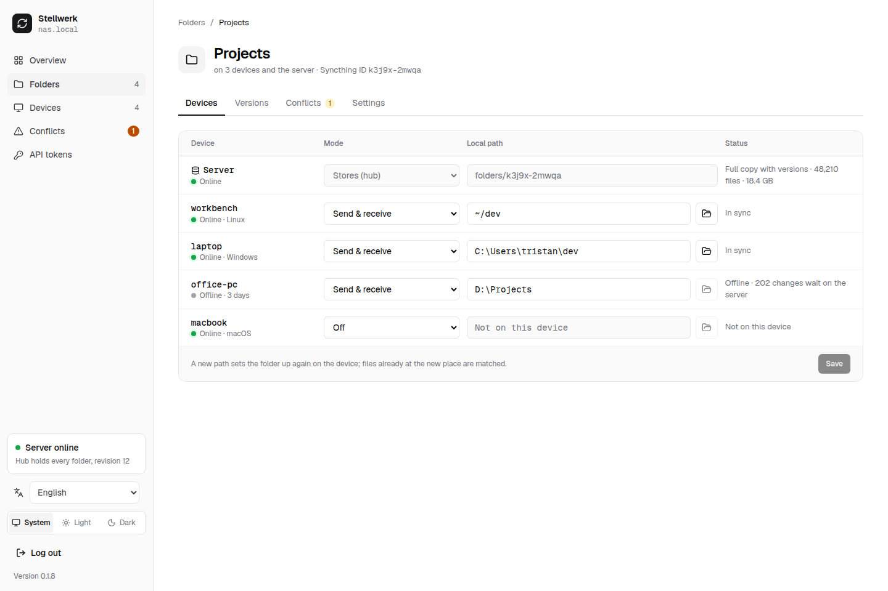
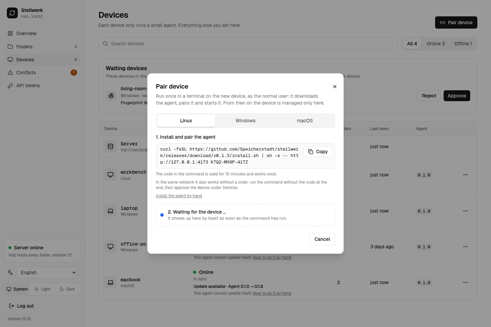
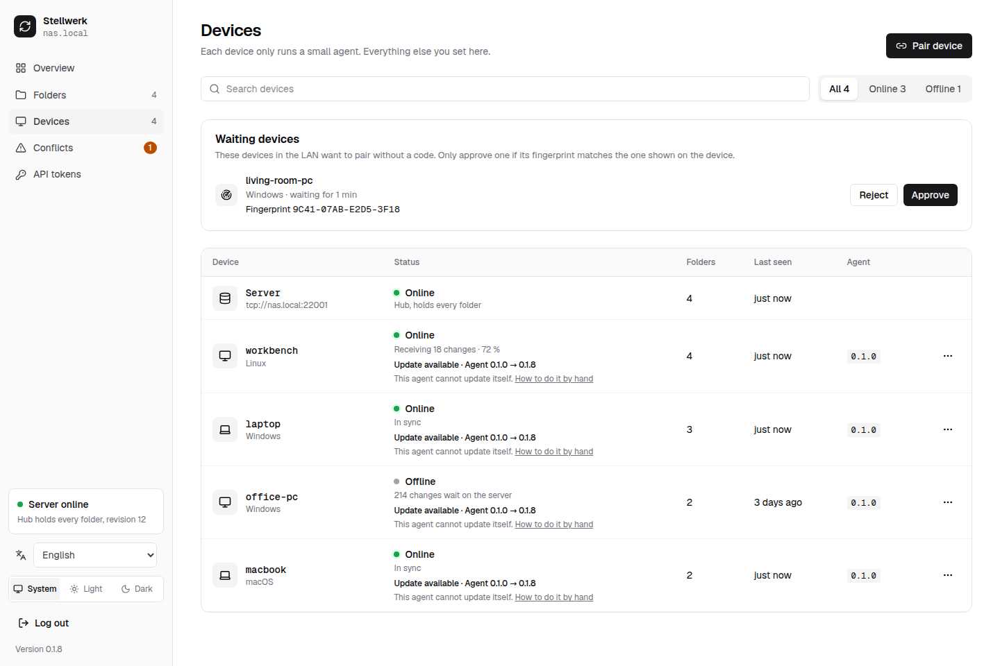
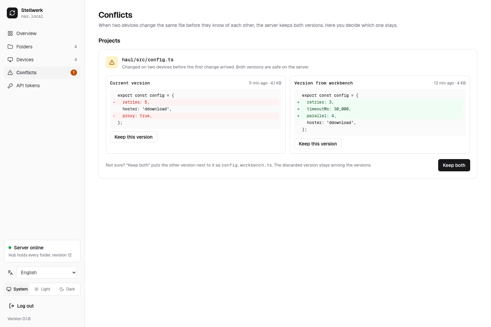

<!-- Die Seite zum Weitergeben: was Stellwerk kann, in Bildern. Details stehen auf den verlinkten
     Seiten und in overview.md; die Bilder entstehen mit `bun run screenshots` (development.md). -->

<div class="showcase-hero" markdown>

<p class="showcase-kicker">Zentrale Weboberfläche für Syncthing, selbst gehostet</p>

# Alle Ordner. Alle Geräte. Eine Stelle.

<p class="showcase-claim">Projektordner, Vorlagen und Pläne im Büro wie auf dem Laptop an der
Baustelle – aktuell auf allen Rechnern, ohne Cloud-Abo, ohne Fileserver und ohne auf jedem PC
„annehmen“ zu klicken.</p>

<a href="demo/" class="md-button md-button--primary">Demo ausprobieren</a> [Rundgang starten](#rundgang){ .md-button } [Installieren](installation.md){ .md-button } [Dokumentation](overview.md){ .md-button }

<p class="showcase-hinweis">Stellwerk ist noch in der Beta: vor jedem Update <a href="installation.html#sichern-und-wiederherstellen">sichern</a>.</p>

</div>

<div class="showcase-shot showcase-shot--hero" markdown>
<a href="demo/">
{ width="1440" height="1307" }
{ width="1440" height="1068" }
</a>
</div>

<div class="showcase-feature" id="rundgang" markdown>
<div markdown>
<span class="showcase-kicker">Matrix · Ordner und Pfade</span>

## Einmal festlegen, wer welchen Ordner bekommt

Ein Klick pro Zelle für beide Richtungen, nur senden, nur empfangen oder aus. Den lokalen Pfad
auf einem Gerät wählst du per Klick durch seine Verzeichnisse. Änderungen sammeln sich als Entwurf
und gehen als eine nummerierte Revision an alle Geräte hinaus.

[Die Matrix](user-guide.md#the-matrix) · [Ordnerseite](user-guide.md#folder-page)
</div>
<div class="showcase-shot" markdown>
{ width="1440" height="960" loading="lazy" }
</div>
</div>

<div class="showcase-feature showcase-feature--flip" markdown>
<div markdown>
<span class="showcase-kicker">Gerät koppeln</span>

## Ein Befehl pro Gerät. Fertig.

Einen Einmal-Code erzeugen, den angezeigten Befehl auf Linux, Windows oder macOS ausführen – oder
das Gerät im lokalen Netz ohne Code über mDNS freigeben. Der Agent läuft als normaler Benutzer,
bringt sein eigenes Syncthing mit und fasst eines, das du schon betreibst, nie an.

[Gerät koppeln](user-guide.md#pair-device) · [Erste Schritte](getting-started.md)
</div>
<div class="showcase-shot" markdown>
{ width="1440" height="960" loading="lazy" }
</div>
</div>

<div class="showcase-feature" markdown>
<div markdown>
<span class="showcase-kicker">Server als Hub · Live-Status</span>

## Kein Stillstand, wenn ein PC aus ist

Der Server ist Mitglied in jedem Ordner und hält eine vollständige Kopie mit Versionen für ein
Jahr. Ist ein Laptop unterwegs ausgeschaltet, wartet seine Revision – sobald er wieder online ist,
holt er Änderungen und Konfiguration von selbst nach.

[Geräte](user-guide.md#gerate) · [Architektur](architecture.md)
</div>
<div class="showcase-shot" markdown>
{ width="1440" height="960" loading="lazy" }
</div>
</div>

<div class="showcase-feature showcase-feature--flip" markdown>
<div markdown>
<span class="showcase-kicker">Konflikte und Versionen</span>

## Konflikte lösen, ohne Dateien zu verlieren

Haben zwei Rechner dieselbe Datei geändert, bevor sie voneinander wussten, hebt der Server beide
Fassungen auf. Du siehst den zeilenweisen Diff nebeneinander und entscheidest, welche bleibt –
oder behältst beide. Ältere Fassungen lassen sich jederzeit wiederherstellen.

[Konflikte](user-guide.md#conflicts) · [Bedienung](user-guide.md)
</div>
<div class="showcase-shot" markdown>
{ width="1440" height="960" loading="lazy" }
</div>
</div>

<div class="showcase-center" markdown>

## Für wen?

</div>

<div class="showcase-cards" markdown>
<div markdown>
**🏗️ Kleine Betriebe und Teams**

Projektordner, Pläne und Vorlagen im Büro und auf dem Laptop unterwegs – ohne Cloud-Abo und ohne
Fileserver mit VPN.
</div>
<div markdown>
**🖥️ Wer mehrere Rechner verwaltet**

Einmal auf dem Server festlegen, welcher PC welchen Ordner bekommt – kein Klicken auf „annehmen“
auf jedem einzelnen Gerät.
</div>
<div markdown>
**🔒 Eigener Server, normale Dateien**

Syncthing überträgt direkt und verschlüsselt. Die Dateien bleiben normale Ordner auf jedem Gerät,
ohne eigenes Speicherformat.
</div>
<div markdown>
**🤖 Automatisierung und MCP**

API-Tokens für Skripte und ein eingebauter [MCP-Server](user-guide.md#claude-code-and-other-assistants-mcp),
damit Assistenten wie Claude Code Ordner suchen und anlegen können.
</div>
</div>

<div class="showcase-center" markdown>

## In drei Schritten installiert

</div>

<div class="showcase-cards" markdown>
<div markdown>
**1. Container starten**

`compose.yaml` auf einem Linux-Server mit Docker oder Podman anlegen und starten.
</div>
<div markdown>
**2. Passwort setzen**

Einmal `stellwerk set-password` ausführen und die Weboberfläche im Browser öffnen.
</div>
<div markdown>
**3. Geräte koppeln**

In der Oberfläche auf **Gerät koppeln** klicken und den Befehl auf jedem Rechner ausführen.
</div>
</div>

```yaml
services:
  stellwerk:
    image: tristanteu/stellwerk:latest
    restart: unless-stopped
    ports: ["8080:8080", "22001:22001"]
    environment:
      STELLWERK_HUB_ADDRESS: tcp://nas.local:22001
    volumes: ["stellwerk:/data"]
volumes:
  stellwerk:
```

<p class="showcase-hinweis">Reverse Proxy mit HTTPS, Podman Quadlet, Backups und Updates stehen in der
<a href="installation.html">Installationsanleitung</a>; keinen eigenen Server? Siehe
<a href="hosted.html">Gehostet oder über einen Partner</a>.</p>

<div class="showcase-hero" markdown>

## Deine Dateien. <span class="showcase-accent">Dein Server.</span>

<p class="showcase-claim">Open Source unter AGPL-3.0, kostenlos. Du brauchst nur einen Server.</p>

<a href="demo/" class="md-button md-button--primary">Demo ausprobieren</a> [Installieren](installation.md){ .md-button } [Dokumentation](overview.md){ .md-button } [Quellcode auf GitHub](https://github.com/Speicherstadt/stellwerk){ .md-button }

</div>
